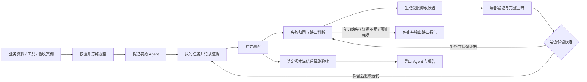
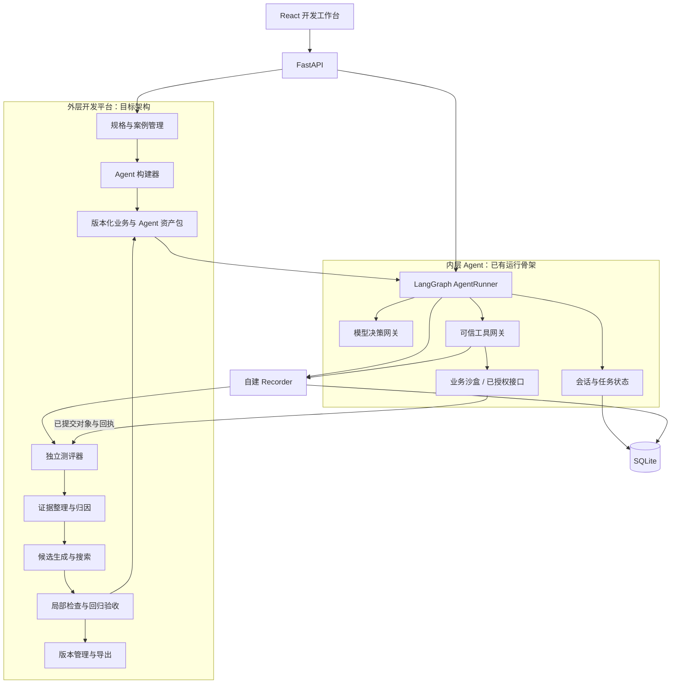

# AutoSale

**测试驱动的外贸销售 Agent 构建与自迭代系统**

从业务资料、可用工具和验收案例出发，在统一框架内构建销售 Agent；根据实际执行记录定位失败，生成受限修改，通过独立测评与回归决定是否保留，最终交付可运行的 Agent 包及未解决问题报告。

> **仓库状态：方案公开阶段。** 本次仅发布 README，源代码、业务数据和运行产物暂未上传。下文明确区分目标设计与本地实现进展；当前仓库尚不能直接安装运行。方案与进度整理于 **2026-09-29**。

## 目录

- [项目定位](#项目定位)
- [输入、输出与完整闭环](#输入输出与完整闭环)
- [总体架构](#总体架构)
- [内层：执行客户任务的 Agent](#内层执行客户任务的-agent)
- [外层：构建、测评与受控迭代](#外层构建测评与受控迭代)
- [测评与版本验收](#测评与版本验收)
- [典型场景](#典型场景)
- [技术选型](#技术选型)
- [当前实现进展](#当前实现进展)
- [实施路线](#实施路线)
- [实验与效果验证](#实验与效果验证)
- [项目边界](#项目边界)

## 项目定位

业务 Agent 的错误可能来自需求理解、业务资料、状态更新、工具调用或回复表达。只看最终回答，很难判断应该修改哪里；一次修改即使修好了当前案例，也可能破坏原本正常的行为。

AutoSale 面向 **AI 应用开发者与业务实施人员**，由业务专家提供事实、规则和验收要求，以外贸销售为首个验证场景，建设从 Agent 构建到迭代交付的开发闭环。

首期业务范围包括：

- **产品问答：** 根据资料回答规格、包装及业务政策问题。
- **需求澄清：** 明确型号、数量、单位、目的地等必要条件。
- **业务查询与报价：** 查询有效价格和库存依据，创建或修订报价草稿。
- **异常与人工转交：** 对缺资料、缺接口或超出权限的事项保留证据并登记转交。

项目将“测试集作为 PRD”具体落实为：**测试集是需求的可执行验收层。** 测试定义可观察的结果，业务资料与工具定义完成任务所需的事实和能力。案例期望不能成为新的价格来源，也不能凭空补出运费或库存。

核心关联链是：

**业务要求 → 测试案例 → 执行记录 → 失败证据 → 可修改资产 → 版本差异 → 回归结果。**

## 输入、输出与完整闭环

以下为目标系统的完整流程，部分环节仍在建设中。

| 类型 | 内容 |
| --- | --- |
| 业务资料 | 产品、型号、计价单位、价格来源、MOQ、库存与交期依据、业务政策 |
| 工具能力 | 已授权的产品查询、价格查询、库存查询、报价草稿和转交接口 |
| 验收案例 | 初始环境、客户目标、客户消息、预期业务结果、禁止行为与结束条件 |
| 运行约束 | 模型配置、步骤与调用上限、优化预算、允许修改的资产范围 |
| 交付结果 | Agent 包、版本差异、测评报告、诊断证据、接纳或拒绝理由、未解决问题 |



每次搜索都有预算和停止条件。未达到交付标准时，可保留实验版本，但报告必须说明尚未满足的要求。

## 总体架构

系统分为两层：**内层 Agent 处理客户任务，外层开发平台构建和改进 Agent。** 内层会话固定版本；外层离线生成候选，经验证后形成新版本。



这些组件首先作为同一后端工程中的模块组织。目标方案使用独立 worker 执行测评、优化等长任务；开放候选代码执行后，再引入容器隔离。

## 内层：执行客户任务的 Agent

内层采用一个业务决策核心，结合显式状态、任务记录和可信工具推进工作。一条客户消息可以同时包含问答、查询和执行要求，各任务分别记录进度。

| 模块 | 职责 |
| --- | --- |
| 业务包加载 | 加载 prompt、skill、字段 schema、任务定义及工具引用，校验版本与内容哈希 |
| 上下文组装 | 汇总当前消息、历史、已确认事实、待办及可见工具结果 |
| 需求理解与决策 | 理解多个诉求，提出事实更新、任务变更和下一步动作 |
| 状态与任务管理 | 校验来源、处理明确更正、维护依赖及等待信息等状态 |
| 工具网关 | 检查权限、参数、版本和调用条件，执行可信工具并保留回执 |
| 结果与回复检查 | 根据实际工具结果更新任务，检查引用和结构化完成声明 |
| 执行记录 | 保存模型请求与返回、工具实参、状态变化、异常及资产关联 |

一次消息的基本执行过程为：

```text
接收消息、去重并绑定版本
  → 组装上下文
  → 模型提出结构化决策
  → 校验并提交事实与任务变更
  → 调用工具、记录结果，再继续决策
  → 回复 / 等待信息 / 转交 / 达到执行上限
  → 保存状态、执行证据与消息回执
```

设计中的关键区分：

- **事实与推测：** “改成 200 箱”与“如果买 200 箱呢”应产生不同处理。
- **客户信息与权威业务数据：** 客户可以确认需求数量，价格、库存和权限由可信来源决定。
- **工具成功与任务完成：** 返回成功标记之后，还需核对业务对象和完成条件。
- **运行结束与验收通过：** 一轮对话正常结束时，任务仍可能等待信息或尚未完成。

客户信息优先在当前会话内维护，并保存来源。跨会话身份关联、长期画像合并与记忆检索留待后续建设。

## 外层：构建、测评与受控迭代

本节描述下一阶段的目标设计。完整的外层自动迭代尚未接入新的内层运行器。

### 1. 将业务需求编译为规格

使用三类规格分离业务含义、验收条件和程序装配：

| 规格 | 定义内容 |
| --- | --- |
| `BusinessSpec` | 业务事实、来源、政策、工具绑定和允许动作 |
| `CaseSpec` | 初始环境、客户行为、结果断言、禁止事件与轮数限制 |
| `AgentSpec` | 组件、skill、prompt、流程配置和执行上限 |

自然语言先转为可核对的草稿，检查缺失条件、冲突和不可验证的断言，再确认并冻结版本。

### 2. 构建实际参与执行的资产

构建器基于已实现的组件生成业务 skill、决策 prompt、工具绑定、受限流程配置和版本 manifest。生成内容必须被运行器实际加载，并可追溯到具体文件和哈希。

初期优先修改 skill 与 prompt。流程配置编译及代码修改按后续里程碑开放；当前内层骨架使用固定的五节点执行图。

### 3. 根据证据定位失败

归因从失败断言与实际结果出发，沿工具输入输出、状态变化和资产版本查找原因。模型提出有限的原因假设与替代解释，再用局部检查验证。

诊断结果应回答：哪里失败、依据是什么、可能应修改什么，以及是否缺少业务事实、外部能力或更明确的规格。执行日志记录可观察行为，不将不可见的模型内部思考作为证据。

### 4. 生成、验证并保留候选

计划通过 GEPA 适配层搜索候选，由平台负责编辑范围检查、结构校验、局部测试、完整回归和版本接纳。

| 阶段 | 允许修改 | 前置条件 |
| --- | --- | --- |
| 第一阶段 | 指定 skill、prompt 等文本资产 | 修改可追溯，实际参与执行，通过独立测评与回归 |
| 第二阶段 | 指定工具适配器、业务状态处理代码 | 候选隔离、接口检查、可信网关与独立评分器 |
| 第二阶段 | 已登记组件之间的有限流程调整 | 编译检查、循环上限、终态检查和业务回归 |

业务事实、正式评分器、最终测试、权限网关、记录器和接纳逻辑均在候选的可编辑范围之外。外层无法通过修改价格表、放宽评分标准或写入测试答案来获得通过。

### 5. 保存版本并交付

每个版本关联父版本、资产哈希、运行器、模型配置、测试结果和接纳理由。目标导出包包含运行入口、业务资产、工具绑定、依赖、配置示例、manifest 与测评摘要，并在干净环境中验证能否启动。

版本启用只影响新会话，已开始的会话继续使用原版本。导出包仍依赖其声明的模型服务与业务接口。

## 测评与版本验收

### 评价真实业务结果

目标测评分为三层：

| 层次 | 方法 | 例子 |
| --- | --- | --- |
| 业务结果 | 独立程序评分 | 有效报价的数量、单位、币种和价格来源是否正确 |
| 必要约束 | 状态与事件检查 | 是否产生未授权折扣、无依据字段或重复业务写入 |
| 语义表现 | 经人工样本校准的模型评分 | 澄清是否清楚，回复是否包含无依据承诺 |

评分器读取已经提交的业务对象和回执。Agent 回复“已创建报价”本身不能证明任务完成；关键项无法判断时记为待核验。

### 隔离数据与测试环境

- 每次试验从独立业务快照开始，避免候选之间共享客户状态。
- 按任务家族划分开发集、选版验证集和最终测试集，避免同一任务的改写版本跨集合泄漏。
- 销售 Agent 只获得合法客户消息和业务工具；评分断言由测试运行器与评分器独立持有。
- 最终测试不参与初始构建、诊断和候选选择，也不将其答案摘要提供给优化器。
- 多轮测试使用有目标和分支的客户脚本，随 Agent 的追问作出响应。

### 区分候选保留与交付验收

**候选保留**要求目标表现改善、关键约束通过、原有场景无超出预设阈值的退化，并符合成本与证据要求。

**交付验收**在版本和协议冻结后进行，通过独立最终测试与预先声明的重复试验要求，且无未裁决的关键项，才标记为 `validated`。

未验收版本可作为实验产物保存或导出，状态必须明确；只有通过交付验收的版本才能按目标方案正式启用。

## 典型场景

以下用于说明目标闭环，不代表已经完成的自动修复效果。

### 场景一：修复单位澄清遗漏

客户说“需要 100”，初始 Agent 未确认单位就创建报价。测评发现缺少必要条件，执行记录显示其采用了默认单位。外层据此修改实际加载的 skill，再回归检查三种情况：缺少单位时追问、当前消息已明确单位时继续执行、历史已确认单位时避免重复追问。

### 场景二：定位数量更正失败

客户将需求从 100 箱改为 200 箱，模型提出了正确更正，但状态或报价仍保留 100。系统通过决策、状态差异和工具参数定位问题。第二阶段可在隔离环境中修订指定代码，再从初始环境完整重跑验证。

### 场景三：识别无法自动补齐的能力

客户要求包含运费和税费的报价，但系统只有商品价格接口。外层输出缺口：受影响要求、已有证据、缺少的服务及输入条件。新增代码可以封装已有能力；真实数据、账户和授权仍需外部提供。

停止编造费用属于行为改善，原先“完成含运费报价”的任务仍应记录为未完成。

## 技术选型

| 层次 | 当前采用或计划选型 | 状态 |
| --- | --- | --- |
| 后端 | Python、FastAPI、Pydantic | 已有本地实现 |
| 前端 | React、TypeScript、Vite | 已有旧版工作台；新版待建设 |
| Agent 执行 | LangGraph、项目自建 AgentRunner | 新内层骨架已实现 |
| 模型接入 | 自建网关，支持 OpenAI Responses API | 已实现协议接入；真实模型效果待验证 |
| 状态与证据 | SQLite WAL、自建 Recorder、内容哈希 | 已有本地实现；新版 payload 当前保存在 SQLite |
| 测评 | Python grader、客户脚本、语义评分 | 旧版已有规则测评；新版体系待建设 |
| 候选搜索 | GEPA 适配层 | 计划接入 |
| 长任务 | 独立 worker 与持久化作业 | 计划建设 |
| 候选代码隔离 | Docker | 第二阶段计划 |
| 工程验证 | pytest、Ruff、TypeScript 检查、Vite 构建 | 已用于本地工程 |

首期按单用户、单机规模设计。监控默认自建；知识查询先采用结构化或基础文本检索，根据测评结果决定是否引入向量检索。

## 当前实现进展

截至 2026-09-29，本地工程包含两个阶段的实现。两者尚未合并为完整的新版自动迭代系统。

| 部分 | 已有能力 | 当前限制 |
| --- | --- | --- |
| v0.1 销售沙盒 | 业务配置、销售对话、报价草稿、trace、合成案例评分、版本与独立导出 | 固定销售流程；改进器只修改 4 个预登记布尔策略字段 |
| v2 内层骨架 | LangGraph 决策循环、业务包校验、状态与任务管理、可信工具网关、自建记录和 `/api/v2` | 固定执行图；演示工具使用合成环境；尚未接入完整外层闭环 |
| 模型网关 | 真实模型协议接入、结构校验、调用证据与错误记录 | 工程验证使用脚本决策及 HTTP 模拟；尚无真实模型效果结论 |
| 前端 | 可操作的 v0.1 工作台 | 仍使用旧接口，新内层通过 API 与 Python 接口使用 |

v0.1 已用 **18 条合成验收案例**演示规则策略修复和回归门禁。这些案例包含人为故障注入，验证集参与选版，尚无独立最终测试；其通过率不能作为新版 LLM Agent 自主改进能力的证明。

新内层骨架已覆盖消息去重、固定版本、来源校验、任务依赖、工具调用证据和不确定副作用状态。自动中断恢复、跨会话画像、通用自由文本真实性检查、新内层独立导出，以及外层构建与自动迭代仍待完成。

当前 GitHub 仓库仅提供本说明。源码发布后再补充安装步骤、运行示例、测试命令与可复现结果。

## 实施路线

| 里程碑 | 主要工作 | 验收标志 | 当前进度 |
| --- | --- | --- | --- |
| M1：执行与证据 | 统一运行器、模型与工具网关、状态和 trace 展示 | 多轮任务能检查实际请求、工具结果和状态变化 | 内层骨架已完成；真实模型验证与新版页面待补 |
| M2：构建与测评 | 规格编译、初始资产生成、业务沙盒、客户脚本与独立评分 | 不同业务配置产生实际不同资产，案例隔离且失败可检查 | 计划中 |
| M3：文本自动迭代 | 证据归因、GEPA 接入、skill/prompt 修改、回归和导出 | 修复自然失败、拒绝退化候选、正确报告能力缺口，导出冷启动通过 | 计划中；首阶段完整交付点 |
| M4：代码与流程增强 | 容器隔离、指定代码修改、有限流程编辑、按需分支验证 | 代码与流程变更有实际执行证据，越界修改被拒绝 | 后续增强 |
| M5：正式实验 | 冻结协议、未见测试、等预算对照、重复搜索和成本报告 | 结果可追溯，失败与限制完整披露 | 计划中，可先在 M3 范围内开展 |

各阶段按可运行证据验收。自动新增工具优先从规则明确的计算工具开始，再考虑已授权数据库或 API 的适配器生成。

## 实验与效果验证

待验证的问题是：**在相同模型、初始版本、编辑范围和总预算下，结构化业务证据与受控验证，能否更稳定地提升未见任务表现，并减少无效修改？**

计划比较固定初始版本、通用反馈驱动的 GEPA 优化，以及加入本项目结构化证据与检查的优化。对照共享公平的信息条件，额外诊断与检查的消耗计入总预算。

主要报告任务成功率、关键违规率、回归率、重复运行稳定性、修复成功率，以及总调用量、费用和耗时。自然失败与注入故障分别统计；缺口报告同时检查正确停止与过早停止。

目前尚未完成正式对照实验，也未建立真实销售收益或开发效率提升结论。

## 项目边界

- 优化对象是 prompt、skill、受限代码与流程等应用资产，模型权重保持不变。
- 自动修改在离线开发作业中执行，客户会话使用固定版本。
- 首期限定统一框架与单一业务方向，任意外部 Agent 接入、多框架兼容和多租户 SaaS 不在当前范围内。
- 真实 CRM、消息渠道、支付和生产身份权限尚未接入；报价、库存等演示数据为明确标注的合成资料。
- 代码生成不能创造不存在的业务事实、外部接口或操作权限。
- 合成环境中的测试结果只说明对应条件下的行为，真实业务效果需要后续独立验证。
